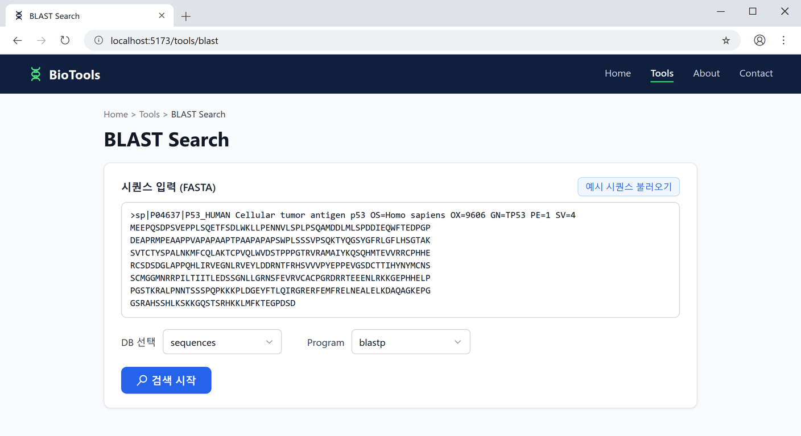
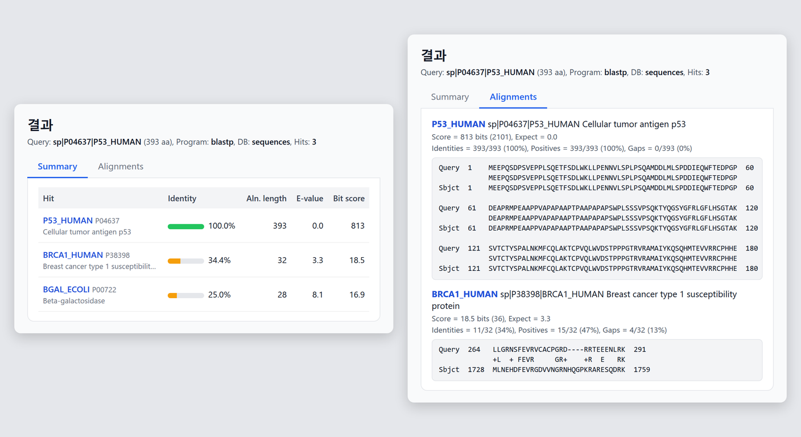

# 10장. BLAST 검색 도구 만들기

## 10.1 BLAST란?

**BLAST(Basic Local Alignment Search Tool)**는 생명정보학에서 가장 많이 사용되는 서열 유사성 검색 도구다. 입력한 DNA 또는 단백질 서열과 유사한 서열을 데이터베이스에서 찾아주며, NCBI에서 제공하는 웹 버전(https://blast.ncbi.nlm.nih.gov)이 가장 널리 알려져 있다.

BLAST의 기본 원리는 간단하다. "이 서열과 비슷한 서열이 데이터베이스에 있는가?"를 묻는 것이다. 새로 시퀀싱한 유전자의 기능을 예측하거나, 종간 상동 유전자를 찾거나, 클로닝한 서열의 정체를 확인할 때 가장 먼저 사용하는 도구이다. 생물학 연구실에서 "BLAST 돌려봤어?"는 일종의 관용구처럼 쓰인다.

이 장에서는 7~9장에서 배운 SvelteKit + Tailwind CSS + PostgreSQL 기술 스택을 활용하여 **나만의 BLAST 검색 웹 도구**를 Claude Code로 만든다. NCBI의 BLAST+ 명령줄 도구를 백엔드에서 실행하고, 결과를 웹 인터페이스로 보여주는 구조다.

### 이 장에서 사용하는 도구와 개념

이 장을 진행하면서 처음 접하게 되는 도구와 개념을 미리 정리한다. 코드를 직접 작성할 필요는 없지만, 이런 도구가 어떤 역할을 하는지 알아야 Claude Code에게 정확한 지시를 내릴 수 있다.

| 도구/개념 | 설명 |
|-----------|------|
| **BLAST+** | NCBI에서 제공하는 명령줄 서열 검색 도구 모음. `blastn`(핵산 대 핵산), `blastp`(단백질 대 단백질), `blastx`(핵산을 단백질로 번역하여 검색), `tblastn`(단백질로 핵산 DB 검색) 등이 포함된다. |
| **makeblastdb** | FASTA 파일을 BLAST가 검색할 수 있는 인덱스 형식의 데이터베이스로 변환하는 명령어. 책의 색인과 비슷한 역할이다. |
| **FASTA 형식** | 생물학적 서열을 표현하는 텍스트 형식. `>`로 시작하는 헤더 줄과 그 아래 서열 줄로 구성된다. |
| **E-value** | 같은 크기의 데이터베이스를 검색했을 때, 이 정도 점수 이상의 매칭이 우연히 나올 것으로 기대되는 횟수. 확률이 아니라 기대 횟수이므로 1보다 클 수도 있다. 값이 작을수록 의미 있는 유사성이며, 흔히 1e-5 이하를 유의미한 결과로 본다. |
| **Identity (%)** | 쿼리 서열과 매칭된 서열 사이에서 동일한 잔기(residue)의 비율. 95%면 매우 유사, 30% 미만이면 상동 관계를 의심해 봐야 한다. |
| **child_process** | Node.js에서 외부 명령(예: `blastp`)을 실행할 수 있게 해주는 모듈. SvelteKit 서버에서 BLAST+를 호출할 때 사용된다. 셸을 거치지 않고 명령과 인자를 배열로 전달하는 `execFile`, `spawn` 함수를 사용하는 것이 안전하다. |
| **명령 주입(command injection)** | 사용자 입력이 시스템 명령에 직접 포함되어 의도하지 않은 명령이 실행되는 보안 취약점. 사용자 입력은 임시 파일로 전달하고, 명령은 셸 없이 인자 배열로 실행하면 이 위험을 크게 줄일 수 있다. |

### 완성된 도구의 모습

이 장을 마치면, 다음과 같은 구조의 BLAST 검색 웹 도구가 완성된다. 9장에서 배운 단일 도구 페이지 패턴을 따르되, BLAST 특유의 프로그램 선택과 다중 결과 표시를 추가한 형태이다.

```
┌──────────────────────────────────┐
│  Navbar                          │
├──────────────────────────────────┤
│  Home > Tools > BLAST Search     │
│  BLAST Search                    │
├──────────────────────────────────┤
│  ┌────────────────────────────┐  │
│  │  시퀀스 입력 (FASTA)       │  │
│  │  ┌──────────────────────┐  │  │
│  │  │ >query1              │  │  │
│  │  │ MEEPQSDPSVEP...      │  │  │
│  │  └──────────────────────┘  │  │
│  │  DB 선택: [sequences ▾]    │  │
│  │  Program: [blastp ▾]       │  │
│  │  [검색 시작]               │  │
│  └────────────────────────────┘  │
├──────────────────────────────────┤
│  결과                            │
│  ┌────────────────────────────┐  │
│  │  [Summary] [Alignments]    │  │
│  │  ┌──────────────────────┐  │  │
│  │  │ P53_HUMAN    100.0%  │  │  │
│  │  │ BRCA1_HUMAN   34.4%  │  │  │
│  │  │ BGAL_ECOLI    25.0%  │  │  │
│  │  └──────────────────────┘  │  │
│  └────────────────────────────┘  │
├──────────────────────────────────┤
│  Footer                          │
└──────────────────────────────────┘
```



## 10.2 BLAST+ 설치와 데이터베이스 준비

BLAST 검색 기능을 구현하려면 먼저 BLAST+ 도구와 검색 대상 데이터베이스가 필요하다. 이 과정을 Claude Code에게 맡길 수 있다.

### Docker에 BLAST+ 추가

Docker를 활용하여 BLAST+를 개발 환경에 추가한다. Claude Code에게 다음과 같이 요청한다:

> 프로젝트의 Dockerfile에 BLAST+를 추가해줘. 베이스 이미지를 Debian 기반의 node:24-slim으로 바꾸고, apt-get install ncbi-blast+로 설치해줘.

7장에서는 가벼운 Alpine Linux 기반의 `node:24-alpine` 이미지를 사용했다. 그러나 Alpine Linux의 패키지 저장소에는 `ncbi-blast+` 패키지가 없다. 반면 Debian 저장소에는 이 패키지가 있으므로, BLAST를 사용하는 이 장에서는 Debian 기반의 `node:24-slim` 이미지로 바꾼다. Claude Code가 Dockerfile을 수정하여 BLAST+ 명령줄 도구(`blastn`, `blastp`, `makeblastdb` 등)를 컨테이너에 설치해 준다. 이런 판단은 Docker와 리눅스 패키지 관리에 대한 기본적인 이해가 있어야 가능하다.

Debian 저장소의 BLAST+는 NCBI가 배포하는 최신 버전보다 오래된 버전일 수 있다. 이 장의 실습에는 충분하지만, 최신 기능이 필요하다면 NCBI가 배포하는 실행 파일(https://ftp.ncbi.nlm.nih.gov/blast/executables/blast+/LATEST/)을 내려받아 설치하도록 요청한다. 설치된 버전은 컨테이너 안에서 `blastp -version`으로 확인할 수 있다.

### 예시 데이터베이스 준비

BLAST 검색에는 검색 대상이 되는 **시퀀스 데이터베이스**가 필요하다. NCBI의 nr(non-redundant) 단백질 데이터베이스는 압축된 상태로도 수백 GB에 달하므로, 개발 단계에서는 소규모 데이터베이스를 직접 만들어 사용한다.

> UniProt에서 TP53(P04637), BRCA1(P38398), beta-galactosidase(P00722) 단백질 서열을 내려받아 data/sequences.fasta로 저장하는 스크립트를 만들어줘. https://rest.uniprot.org/uniprotkb/P04637.fasta 같은 주소를 사용하면 돼. 그리고 makeblastdb로 단백질 BLAST 데이터베이스를 생성하는 스크립트도 만들어줘.

Claude Code가 서열 다운로드 스크립트와 데이터베이스 생성 스크립트를 만들어 준다. 서열을 AI에게 직접 써 달라고 하지 않고 UniProt에서 내려받게 하는 이유는, AI가 기억에 의존해 쓴 서열은 실제 서열과 다를 수 있기 때문이다. 공식 데이터베이스에서 받은 서열을 써야 검색 결과를 믿을 수 있다. `makeblastdb` 명령으로 FASTA 파일을 BLAST가 검색할 수 있는 인덱스 형식으로 변환하는 과정이다. 도서관에서 책을 찾으려면 색인이 필요하듯, BLAST도 서열을 빠르게 찾으려면 인덱싱된 데이터베이스가 필요하다.

여기서 "TP53, BRCA1"같은 구체적인 유전자 이름과 UniProt 접근 번호를 제시할 수 있는 것이 도메인 지식의 힘이다. AI에게 "아무 서열이나 넣어줘"라고 하면 의미 없는 랜덤 서열이 나올 수 있지만, 실제 연구에서 자주 다루는 유전자를 지정하면 테스트할 때도 결과를 검증하기 쉽다.

이 데이터베이스는 단백질 서열로 만들었으므로, 단백질 데이터베이스를 검색하는 `blastp`(단백질 쿼리)와 `blastx`(핵산 쿼리를 번역하여 검색)로 사용할 수 있다. `blastn`과 `tblastn`은 핵산 데이터베이스를 검색하므로, 이 두 프로그램까지 쓰려면 핵산 서열로 만든 데이터베이스가 따로 필요하다. 마찬가지로 nr은 단백질 데이터베이스이므로 `blastn`으로는 검색할 수 없다. 프로그램과 데이터베이스 종류를 맞추는 것도 도메인 지식이다.

### compose.yml 업데이트

> compose.yml과 compose.dev.yml에 BLAST 데이터베이스 볼륨을 추가해줘. data 디렉토리를 컨테이너의 /app/data에 마운트하고, BLAST_DB_PATH 환경변수도 설정해줘. 이 변수는 src/env.ts에도 선언해줘.

이렇게 하면 Docker 컨테이너 안에서 BLAST 데이터베이스에 접근할 수 있게 된다. 3장에서 배운 볼륨 마운트와 환경 변수 개념이 여기서 활용된다. 7장에서 본 것처럼 SvelteKit 3에서는 새 환경 변수를 `src/env.ts`에 선언해야 서버 코드에서 `$app/env/private`로 가져올 수 있다.

## 10.3 백엔드 API 구현

### BLAST 실행 함수

웹 인터페이스에서 BLAST를 실행하려면, SvelteKit 서버에서 BLAST+ 명령줄 도구를 호출하는 함수가 필요하다. Claude Code에게 다음과 같이 요청한다:

> BLAST를 실행하는 서버 함수를 만들어줘. src/lib/server/blast.ts에 작성하고, 사용자가 입력한 시퀀스를 임시 파일에 저장한 다음 BLAST+ 명령을 실행하는 방식으로 구현해줘. blastn, blastp, blastx, tblastn을 지원하되, 프로그램마다 맞는 데이터베이스 종류(단백질/핵산)를 사용해줘. 보안을 위해 사용자 입력을 명령줄에 직접 전달하지 말고 파일 경로만 전달해줘. 명령은 셸을 거치지 않도록 child_process의 execFile이나 spawn에 인자 배열로 전달해줘.

Claude Code가 `child_process`로 BLAST 명령을 실행하는 TypeScript 함수를 작성해 준다. 여기서 핵심은 **보안 요구사항을 명시적으로 전달**하는 것이다. 사용자가 입력한 시퀀스를 명령줄 인자로 직접 전달하면 명령 주입(command injection) 공격에 취약해진다. 임시 파일에 먼저 저장하고 파일 경로만 전달하면 이 위험을 크게 줄일 수 있다.

명령을 실행하는 방식도 중요하다. `exec`처럼 명령 전체를 하나의 문자열로 만들어 셸에서 실행하면, 문자열에 섞인 `;`나 `|` 같은 문자가 셸 명령으로 해석될 수 있다. `execFile`이나 `spawn`에 `['-query', queryPath, '-db', dbPath]`처럼 인자를 배열로 넘기면 셸을 거치지 않으므로, 각 인자가 그대로 BLAST 프로그램에 전달된다.

이처럼 보안 요구사항은 AI가 알아서 처리해 줄 것이라 기대하기보다, 사람이 명시적으로 요청하는 것이 안전하다.

### API 엔드포인트

> SvelteKit API 엔드포인트를 만들어줘. POST /api/blast로 시퀀스와 프로그램 종류를 받아서 BLAST 검색을 실행하고 결과를 JSON으로 반환해줘. 시퀀스 길이 검증(최소 10자, 최대 10,000자)과 프로그램 종류 검증도 포함해줘.

7장에서 배운 `+server.ts` 파일의 역할이 여기서 실현된다. `src/routes/api/blast/+server.ts`에 API 엔드포인트가 생성되면, 프론트엔드에서 `POST /api/blast`로 요청을 보내 BLAST 검색을 실행할 수 있다.

입력 검증도 중요하다. 시퀀스 길이에 제한을 두지 않으면, 누군가 수 MB짜리 서열을 입력하여 서버에 과부하를 걸 수 있다. 이런 방어적 요구사항은 개발 경험에서 나오는 것이지만, 이 책에서는 "입력 검증을 포함해줘"라고 요청하는 것만으로 충분하다.

## 10.4 검색 결과를 데이터베이스에 저장

검색 이력을 관리하기 위해 PostgreSQL에 결과를 저장한다. 사용자가 이전에 실행한 검색을 다시 확인하거나, 같은 검색을 반복하지 않도록 하기 위함이다.

### 데이터베이스 스키마와 저장 로직

> BLAST 검색 이력을 PostgreSQL에 저장할 수 있게 해줘. blast_searches 테이블에 쿼리 시퀀스와 프로그램 종류를 저장하고, blast_hits 테이블에 각 hit의 subject, identity, e-value 등을 저장해줘. 트랜잭션으로 감싸서 저장 중 오류가 나면 롤백되게 해줘.

Claude Code가 스키마 파일(SQL), 데이터베이스 연결 모듈, 검색 결과 저장 함수를 만들어 준다. "트랜잭션으로 감싸줘"라는 요청은, 검색 결과 저장 도중 에러가 발생했을 때 부분적으로만 저장되는 것을 방지한다. 검색 정보는 저장되었는데 hit 목록은 빠져 있는 상황을 막는 것이다.

이런 요청을 하려면 "트랜잭션"이라는 데이터베이스 개념을 알아야 한다. 자세한 SQL 문법을 몰라도 되지만, "여러 테이블에 걸친 저장은 원자적으로 처리되어야 한다"는 개념은 이해하고 있어야 AI에게 올바른 지시를 내릴 수 있다.

## 10.5 프론트엔드 구현

### 검색 폼과 결과 화면

이제 사용자가 실제로 상호작용하는 웹 페이지를 만든다. 9장에서 배운 도구 페이지 디자인 패턴을 BLAST에 맞게 적용한다.

> BLAST 검색 페이지를 만들어줘. /tools/blast 경로로 접근 가능하게 하고: FASTA 시퀀스 입력 textarea, BLAST 프로그램 선택 드롭다운 (blastn, blastp, blastx, tblastn), 예시 시퀀스 불러오기 버튼, 검색 시작 버튼 (로딩 중 스피너 표시), 결과를 Summary 탭과 Alignments 탭으로 나눠서 보여줘. Summary는 테이블로 hit 목록 (identity 막대 그래프 포함), Alignments는 각 hit의 서열 정렬을 코드 블록으로 표시. Tailwind CSS로 스타일링하고, Breadcrumb도 넣어줘.

이 프롬프트에는 8~9장에서 배운 컴포넌트 이름이 모두 들어가 있다. Textarea, Dropdown, Button, Spinner, Tab, Table, Code Block, Breadcrumb 같은 용어를 정확히 사용하기 때문에 AI가 의도한 UI를 생성할 수 있다. "예시 시퀀스 불러오기 버튼"은 사용자 편의를 위한 것으로, 클릭하면 미리 준비된 테스트 서열이 Textarea에 채워진다.

프롬프트 하나로 검색 폼, 결과 테이블, 정렬 뷰가 포함된 페이지가 생성된다. 7~9장에서 만든 레이아웃과 스타일이 자동으로 반영된다.



## 10.6 AI를 활용한 확장

기본 BLAST 도구가 완성되면, Claude Code에게 점진적으로 기능을 추가 요청할 수 있다. 처음부터 모든 기능을 넣으려 하면 복잡도가 급격히 올라가므로, 핵심 기능부터 만들고 하나씩 확장하는 것이 바이브 코딩의 효과적인 패턴이다.

### 프롬프트 예시

> BLAST 결과에 시각화를 추가해줘. 각 hit의 alignment 위치를 수평 막대 그래프로 보여주는 AlignmentViewer 컴포넌트를 만들어줘. query 서열 전체를 회색 막대로, 각 hit의 매칭 영역을 색상 막대로 겹쳐서 표시해줘.

이 시각화는 NCBI BLAST 웹사이트에서 "Graphic Summary"라고 불리는 기능이다. 어떤 영역에 hit가 집중되어 있는지 한눈에 볼 수 있어 유용하다.

> BLAST 검색 이력 페이지를 만들어줘. /tools/blast/history 경로로 접근 가능하게 하고, PostgreSQL에 저장된 이전 검색 결과를 테이블로 보여줘. 각 행을 클릭하면 해당 검색 결과를 다시 볼 수 있게 해줘.

> FASTA 파일 업로드 기능을 추가해줘. 텍스트 입력 대신 .fasta 파일을 드래그 앤 드롭으로 업로드할 수 있게 해줘. 파일 크기는 최대 1MB로 제한해줘.

> BLAST 결과를 CSV 파일로 다운로드하는 기능을 추가해줘. Summary 탭의 테이블 데이터를 CSV로 내보내는 버튼을 만들어줘.

이처럼 기본 구조를 먼저 만들고, 시각화 → 이력 관리 → 파일 업로드 → 내보내기 순으로 기능을 확장해 나간다. 각 단계에서 결과를 확인하고 문제가 있으면 수정한 뒤 다음 기능을 추가한다.

## 10.7 보안 점검

기능 구현이 어느 정도 완료되면, 7장에서 배운 것처럼 보안 점검을 수행한다:

> 프로젝트 전체를 포괄적으로 보안 점검하고, 문제가 있으면 수정해줘

BLAST 도구는 사용자 입력을 받아 시스템 명령(blastn, blastp)을 실행하므로, **명령 주입(command injection)** 취약점에 특히 주의해야 한다. 보안 점검을 통해 사용자 입력이 적절히 검증되고 있는지, 파일 업로드 크기 제한이 동작하는지, 데이터베이스 쿼리에 SQL 인젝션 위험이 없는지 확인한다.

## 10.8 정리

- **BLAST+ Docker 환경 구성**: Alpine에는 ncbi-blast+ 패키지가 없으므로 Debian 기반 `node:24-slim` 이미지에 apt-get으로 설치하도록 Dockerfile과 compose 파일 수정을 요청
- **데이터베이스 준비**: UniProt에서 실제 서열을 내려받고 makeblastdb로 검색용 인덱스 생성. 프로그램(blastp, blastn 등)과 데이터베이스 종류(단백질/핵산)를 맞추기
- **백엔드 API**: BLAST 실행 함수와 API 엔드포인트 생성을 요청하되, 보안 요구사항(임시 파일 사용, 셸 없이 `execFile`/`spawn`에 인자 배열 전달)을 명시
- **프론트엔드**: 검색 폼, 결과 테이블, 정렬 뷰를 컴포넌트 이름을 사용하여 요청
- **데이터베이스 연동**: 검색 이력 저장 기능을 요청하면 스키마부터 저장 로직까지 생성
- **점진적 확장**: 기본 도구를 먼저 만들고, 시각화, 이력 관리, 파일 업로드 등을 단계적으로 추가

이 장에서 볼 수 있듯이, 코드를 한 줄도 직접 작성하지 않았다. BLAST+가 무엇인지, FASTA 형식이 어떻게 생겼는지, E-value가 무엇을 의미하는지, 명령 주입이 왜 위험한지와 같은 **도메인 지식과 기본적인 개발 개념**을 알고 있었기 때문에 Claude Code에게 정확한 지시를 내릴 수 있었다. 바이브 코딩에서 진짜 중요한 것은 코딩 능력이 아니라, **만들고자 하는 것에 대한 이해**다.

파트 3에서는 한 발 더 나아가, 이런 도메인 지식을 조사하고 정리하는 과정까지 AI에게 맡기는 방법을 살펴본다.
